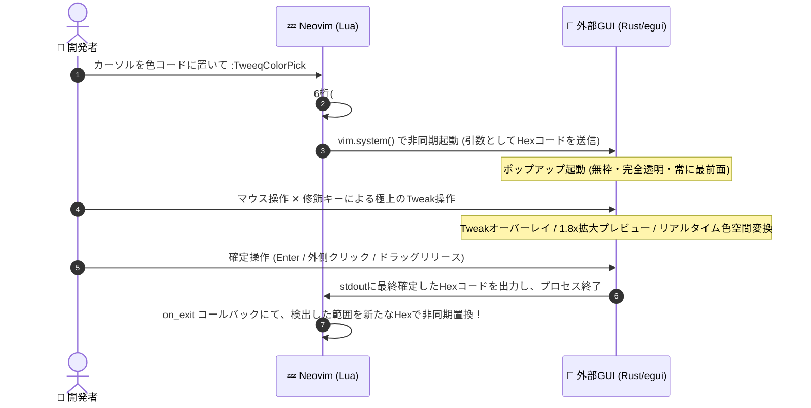

# 🎨 nvim-tweeq-colorpalette

> **TUIの常識を覆す、極上の操作感。**  
> Neovim (Lua) と外部GUI (Rust/egui) の強力なハイブリッド構成により、クリエイター向けUIツール `tweeq` の比類なき高精度カラーピッキングをTUI環境へと持ち込む、次世代のカラーピッカー・プラグイン。

---

## ✨ 主な特徴 (Features)

`nvim-tweeq-colorpalette` は、単なる一般的なカラーピッカーではありません。思考を妨げない直感的かつプロフェッショナルなカラーインタラクションを提供するために設計されています。

*   **🪟 近未来的なポップアップUI (Borderless & Transparent)**  
    枠なし（Borderless）、完全背景透明（Transparent）、常に最前面（Always-on-top）に表示されるエレガントなGUIウィンドウ。エディタのビジュアルを損なわず、重ね合わせてシームレスに操作できます。
*   **🖱️ 高精度 Tweak ジェスチャー**  
    一般的なカラースライダーのように特定位置をクリックするのではなく、**マウスドラッグの移動量（相対値）**によってカラーパラメータを調整。1px単位の極めて繊細な微調整がストレスなく行えます。
*   **⚡ シームレスな現在値の再キャプチャ (ジャンプ防止)**  
    ドラッグの途中で修飾キー（ShiftやS, Vなど）を押し替えて対象パラメータを切り替えても、値が不自然に跳ぶことはありません。モード切替の瞬間にその時点の値を現在値として自動キャプチャし、ドラッグの継続性を維持します。
*   **🌈 手続き的メッシュ描画の色相環 (Color Wheel)**  
    内部の頂点カラー補間や極座標テクスチャにより手続き的に描画された、滑らかで美しいカラーホイール。無限に回転させながら色彩設計を行うことができます。
*   **👁️ 全画面 Tweak オーバーレイ**  
    ドラッグが開始された瞬間、画面全体を覆う仮想キャンバス（逆オフセットパン対応）へと変化。ドラッグ開始点を起点に以下が出現します：
    *   **拡大プレビュー円 (1.8x)**: 指先で調整中の色をリアルタイムに拡大確認。
    *   **ツールチップラベル**: 現在のモード名と正確な数値をポップアップ表示（例: `Hue 128.4°`, `Sat 45.2%`）。
*   **🧪 6桁 / 8桁 (アルファチャンネル) 双方向自動サポート**  
    バッファ上のカラーコード（`#RRGGBB` と `#RRGGBBAA`）の桁数を自動判定。アルファトグルの有効/無効状態を出力にリアルタイム反映し、Neovimのバッファへ双方向かつ柔軟に置換・同期します。

---

## 🚀 インストール & セットアップ (Installation)

Neovimのパッケージマネージャー [lazy.nvim](https://github.com/folke/lazy.nvim) を使用した設定例です。
プラグイン導入時に、Rust側のバイナリが自動的にリリースビルドされるため、別途コンパイルの手間はありません。

```lua
return {
  "nvim-tweeq-colorpalette",
  -- ローカル開発用、または特定ディレクトリからのロード時
  -- dir = "~/github/nvim-tweeq-colorpalette", 
  
  -- プラグインの読み込みと同時にRustバイナリを自動ビルド
  build = "cargo build --release --manifest-path rust/tweeq-colorpalette-gui/Cargo.toml",
  
  keys = {
    -- 任意のキーマップで起動可能
    { "<leader>tc", "<cmd>TweeqColorPick<cr>", desc = "Tweeq Color Picker" },
  },
  
  config = function()
    require("tweeq-colorpalette").setup({
      -- 必要に応じてオプションを設定（デフォルトのバイナリパス等）
    })
  end
}
```

---

## 🎮 使い方 & ジェスチャー一覧 (Usage & Gestures)

### 1. 起動
Neovim上のカラーコード（例: `#ff5555` または `#ff5555aa`）の上にカーソルを置き、コマンド `:TweeqColorPick` (または割り当てたキーマップ `<leader>tc` 等) を実行します。

### 2. カラーピッキング・ジェスチャー
GUIポップアップが表示されたら、マウスをクリックまたはドラッグすることで、驚くほど滑らかなカラー調整が行えます。

| 操作 / 修飾キー | モード | 挙動・詳細 |
|---|---|---|
| **クリック (Click)** | **パネル表示** | ポップアップUIをトグル表示し、直接のUI操作モードにします。 |
| **通常ドラッグ (Drag)** | **2Dパッド** | **彩度 (Saturation)** と **明度 (Value)** を同時に直感調整します（X軸: 彩度, Y軸: 明度）。 |
| **`Shift` または `H` + ドラッグ** | **色相 (Hue)** | カラーホイール・色相スライダーを無限に周期ラップさせながら調整します。 |
| **`S` + ドラッグ** | **彩度 (Saturation)** | 彩度のみを単一軸で精密に調整します。 |
| **`V` + ドラッグ** | **明度 (Value)** | 明度のみを単一軸（**Y軸**）で精密に調整します。 |
| **`Alt` または `A` + ドラッグ** | **不透明度 (Alpha)** | アルファ（透明度）を調整します。（8桁HEX起動時、またはUIでトグルON時のみ有効） |
| **`R` / `G` / `B` + ドラッグ** | **RGBチャンネル** | それぞれ赤・緑・青のカラーチャンネルを個別で微調整します（自動HSV相互逆変換）。 |
| **確定 (Apply)** | — | `Enter`キー / パネル外クリック / ドラッグのリリースで色を確定し、バッファを置換します。 |
| **キャンセル (Cancel)** | — | `Esc`キーで変更を適用せず安全に終了します。 |

> 💡 **ジャンプ防止のヒント:** 彩度を調整している最中に、そのまま `Shift` キーを押し下げると色相調整へシームレスに切り替わります。その際に値が急激にジャンプすることはなく、快適な色彩チューニングが可能です！

---

## 🏗️ アーキテクチャ概要 (How it Works)

このプラグインは、**極小のフットプリント**と**超高速なUIレスポンス**を両立するために、Neovim (Lua) と Rust (egui) を非同期通信で繋ぐ構成を採用しています。



1.  **軽量かつ独立**: Neovim側は余計なUIプラグイン（`nui.nvim`等）に一切依存せず、Neovim 0.10+ の標準非同期プロセス管理 API (`vim.system`) のみを使用しています。
2.  **型安全と高速描画**: GUI側は Rust で書かれており、GPU（OpenGL等）を活用したハードウェアアクセラレーションによる超高速描画（60fps+）により、ドラッグに対する遅延が一切ありません。
3.  **完全非同期**: ピッカーが起動している間も Neovim 自体が完全にフリーズすることはなく、終了時の stdout をフックしてカラーコードをスマートに差し替えます。

---

## 📄 ライセンス

[MIT License](./LICENSE)
