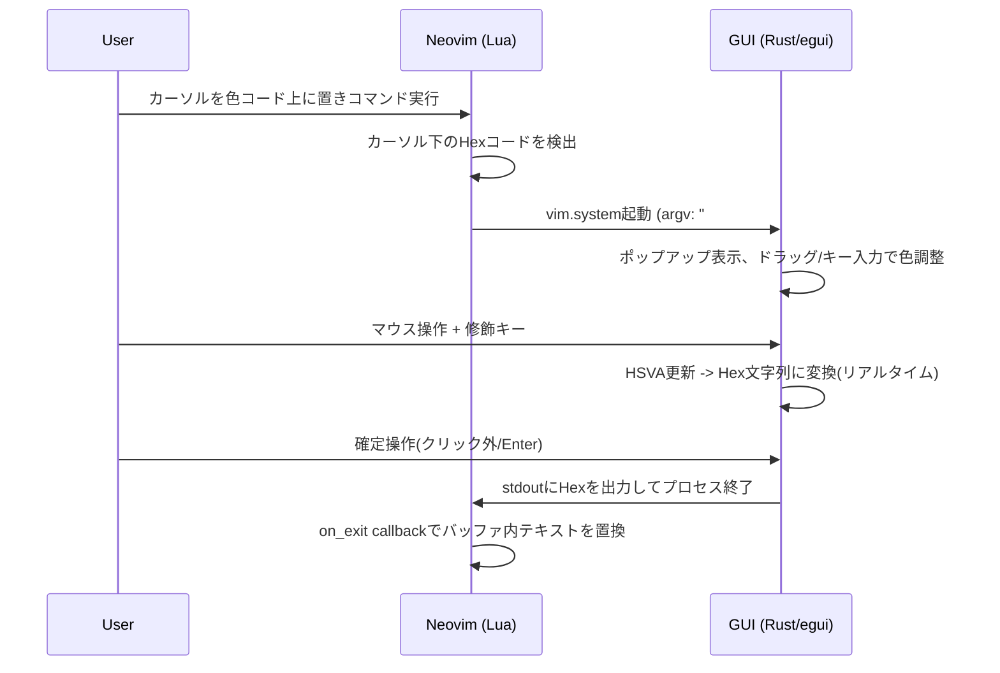
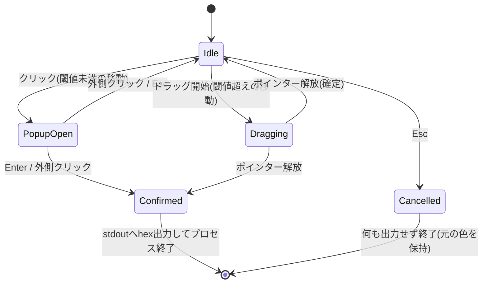

# 実装計画: Neovim Tweeq-like Color Picker

本ドキュメントは `architecture.md` の方針に基づき、`tweeq`(Vue/TypeScript製)のカラーパレット実装を解析して得られた「マウス移動量 + キー入力 → 色の数値変化」ロジックと UI 仕様を整理し、それを Neovim(Lua) + Rust(egui) 構成へ移植するための具体的な実装計画をまとめたものである。

---

## 1. tweeq から抽出した仕様

解析対象ファイル:
- `tweeq/src/InputColor/InputColorPad.vue`(スウォッチボタン + ドラッグ・ジェスチャーの中核)
- `tweeq/src/use/useDrag.ts`(汎用ドラッグ検出プリミティブ)
- `tweeq/src/InputColor/utils.ts`(HSVA数値変換ロジック)
- `tweeq/src/InputColor/types.ts`
- `tweeq/src/InputColor/InputColorPicker.vue` / `InputColorChannelPad.vue` / `InputColorChannelSlider.vue` / `InputColorPresets.vue` / `InputColorChannelValues.vue`
- `tweeq/src/InputColor/{pad,slider,wheel}.frag`(GLSLシェーダー、パッド/スライダー/ホイールの描画ロジック)
- `tweeq/src/TweakOverlay/TweakOverlay.vue`
- `tweeq/src/stores/theme.ts`(サイズ定数)

### 1.1 ドラッグ検出の基本ロジック (`useDrag.ts`)

- `pointerdown` 時点で位置を記録。移動量が **3px(マウス)/ 5px(タッチ)** の閾値を超えて初めて `dragging` 状態に遷移する。閾値未満で `pointerup` した場合は `onClick` が発火する(=クリックとドラッグの排他判定)。
- ドラッグ開始時、対応していれば `requestPointerLock()` を呼び、以後は `event.movementX/Y`(前フレームからの相対移動量)を積算して座標を更新する。これによりカーソルが画面端に到達しても無限にドラッグを継続できる(カーソルは非表示になる)。
- 状態(`DragState`)は `xy`(現在位置) / `previous` / `initial`(ドラッグ開始位置) / `delta`(今フレームの移動量) / `origin`(要素中心。オーバーレイの基準点) を保持。
- `onDrag(state, event)` が移動のたびに呼ばれ、呼び出し側が `state.delta` を使って値を更新する。

### 1.2 モード判定ロジック (`tweakMode`, `InputColorPad.vue` L61-82)

ドラッグ中に**押されているキー**によって、どのチャンネルを操作するかが毎フレーム決定される(`useMagicKeys()` でリアルタイムに監視)。

| 押下キー | モード | 説明 |
|---|---|---|
| (なし) | `pad` | 2軸同時操作(彩度・明度) |
| `Shift` または `H`(`F`も) | `h` | 色相 |
| `S` | `s` | 彩度 |
| `V` | `v` | 明度(Value) |
| `R` | `r` | 赤チャンネル(RGB) |
| `G` | `g` | 緑チャンネル(RGB) |
| `B` | `b` | 青チャンネル(RGB) |
| `Alt` または `A`(`alpha`有効時のみ) | `a` | アルファ |

> `architecture.md` の要件は `Shift/H`・`S`・`V`・`Alt/A`・`R/G/B` のみを規定しており、`F` キーは tweeq 独自の追加ショートカットのため移植対象外とする。

**モード切り替え時の重要な挙動**: ドラッグ中にキーを押し替えてモードが変わった場合、tweeq は `localOnTweak`(基準値)を**その時点の現在値に再キャプチャ**する(`watch(tweakMode, ...)` L195-200)。これにより、モード切替の瞬間に値が飛ばない。

### 1.3 マウス移動量 → 色数値変化の変換式(最重要ロジック)

内部色表現は `HSVA = {h, s, v, a}`(各 `0.0〜1.0` の実数)。RGBは表示・R/G/B編集時にのみ都度変換する。

**正規化**: ドラッグ開始からの累積移動量 `(dx, dy)` [px] を、固定幅 `tweakWidth`(= ポップアップ幅 `240px`)で正規化する。

```
[ndx, ndy] = [dx / tweakWidth, -dy / tweakWidth]   // yは上方向が正になるよう反転
```

**モード別の適用先** (`InputColorPad.vue` L110-155、`utils.ts` の `tweakHSVAChannel` / `setHSVAChannel`):

| モード | 更新式 | クランプ/ラップ |
|---|---|---|
| `pad` | `s += ndx`, `v += ndy` | `s, v` は `[0, 1]` にクランプ |
| `h` | `h += ndx` | `unsignedMod(h, 1)` で `[0,1)` に周期ラップ(色相環) |
| `s` | `s += ndx` | `[0, 1]` クランプ |
| `v` | `v += ndy`(**vだけdy軸**) | `[0, 1]` クランプ |
| `a` | `a += ndx` | `[0, 1]` クランプ |
| `r`/`g`/`b` | 現在のHSVを一旦RGBへ変換し、対象チャンネルに `+= ndx`、その後HSVへ逆変換 | `[0, 1]` クランプ。無彩色(`s=0`または`v=0`)でHが`NaN`になった場合は直前のH/Sを保持 |

擬似コード(`tweakHSVAChannel`):
```
function tweakHSVAChannel(color, channel, delta):
    return setHSVAChannel(color, channel, v => v + delta)

function setHSVAChannel(color, channel, value_or_fn):
    f = as_function(value_or_fn)
    if channel == 'h': new.h = unsignedMod(f(color.h), 1)
    elif channel in ('s','v','a'): new[channel] = clamp(f(color[channel]), 0, 1)
    else: // r, g, b
        rgb = hsv2rgb(color)
        rgb[channel] = clamp(f(rgb[channel]), 0, 1)
        new = {...rgb2hsv(rgb), a: color.a}
        if isNaN(new.h): new.h = color.h
        if isNaN(new.s): new.s = color.s
    return new
```

**ホイール操作(オプション機能)**: ドラッグ中にマウスホイールを回すと、モードに関わらず常に色相を追加調整する: `h += (wheelDeltaY / 360) * 0.5`。500ms 操作が無ければ「ホイール操作中」表示をフェードアウトする。

**マルチセレクトへの比例反映**(tweeq固有機能、`multi.update`)。複数スウォッチの一括編集用ロジックで、彩度/明度は「初期値からの補間比率」、その他チャンネルは「初期値からの倍率(scale)」で他のスウォッチにも反映する。→ **今回の移植では単一カラー編集のみのため対象外**。

### 1.4 色空間変換ロジック (`utils.ts`)

- `rgb2hsv({r,g,b}) -> {h,s,v}` / `hsv2rgb({h,s,v}) -> {r,g,b}`: 標準的なHSV変換式(値域は `0..1`)。
- `hsva2hex(hsva) -> "#RRGGBB[AA]"`: HSVAをRGBに変換し16進文字列化(`chroma-js`使用、Rust版は標準ライブラリで自前実装)。
- `css2hsva(cssColor) -> HSVA`: 任意のCSS色文字列(hex等)をパースしHSVAへ。無効な色は `black` 扱い。
- 色相・彩度が未定義(`NaN`、無彩色時)になった場合は `0` にフォールバックする。

### 1.5 UI の特徴

1. **スウォッチボタン**: `24px`角(`--tq-input-height`)、角丸、背景はチェッカーボード(半透明色を可視化するため)。現在色で塗りつぶし。フォーカス/ホバー/ドラッグ中はアクセントカラーの輪郭線を表示。
2. **クリックでポップアップ表示**: `240px`幅(`--tq-popup-width`)のフローティングパネルがスウォッチ下に表示される。内容(上から順、`DefaultColorPickers`):
   - 2Dパッド(彩度×明度。正方形、GLSLシェーダーでグラデーション生成、円形ドラッグハンドル)
   - 色相スライダー(横長、虹色グラデーション、円形ハンドル)
   - アルファスライダー(チェッカーボード背景 + 透明→不透明グラデーション。**アルファ使用フラグがONの時のみ表示**。フラグの初期値は起動時のHex桁数〔6桁/8桁〕から自動判定され、スライダー横のトグルでいつでもON/OFF切替可能。詳細は2.5節)
   - 数値入力行(`RGB/HSV/HEX` を切り替えるドロップダウン + 各チャンネルの数値入力ボックス。数値入力欄自体もドラッグでスクラブ可能)
   - プリセットカラー行(クリックで即適用)
   - (ブラウザ限定機能)EyeDropper ボタン → **デスクトップでは対象外**
3. **ドラッグ中の「Tweakオーバーレイ」**(`TweakOverlay.vue` + `InputColorPad.vue` L431-477): スウォッチを直接ドラッグしている間だけ、画面全体を覆う透明レイヤーの上に以下を描画する:
   - パッド/ホイール/スライダーのグラフィック(現在のモードに応じて不透明度が変化。非アクティブなグラフィックは`opacity: 0.1`で薄く表示され続ける)
   - グラフィックはドラッグ開始点(`origin`)を基準に配置され、現在値の位置がちょうど開始点(＝ロックされた見えないカーソル位置)に来るよう**逆方向にオフセット**される(=無限パンできる仮想キャンバスの錯覚を作る)
   - 開始点に追従する円形の「プレビュー」スウォッチ(1.8倍に拡大表示)
   - モード名と現在値を表示するツールチップラベル(例: `Hue 128.4°`, `R 200`, `Sat 45.2%`)
   - ドラッグ中はカーソルを非表示にし、ポインターロックで無限ドラッグを実現
4. **キーボードショートカット**: `Ctrl/Cmd+C` でクリップボードに現在の色をコピー、`Ctrl/Cmd+V` で貼り付け(`useCopyPaste`)。
5. **サイズ定数**(`stores/theme.ts`): `popupWidth = 240`, `inputHeight = 24`。これらは移植先でも「ドラッグ感度の基準幅」「スウォッチサイズ」としてそのまま踏襲する。
6. **マルチセレクト機能**(`useMultiSelectStore`): 複数の色入力を同時選択して一括編集する機能。**単一プロセスで1色のみを扱う本プロジェクトでは対象外**。

### 1.6 移植方針まとめ

| tweeq機能 | 移植可否 | 備考 |
|---|---|---|
| クリックでポップアップ開閉 | ✅ 移植 | architecture.md 要件 |
| ドラッグで相対的に色調整 + モードキー | ✅ 移植 | architecture.md 要件。`F`キーのみ除外 |
| ポインターロック的な無限ドラッグ + カーソル非表示 | ✅ 移植(要検証) | 2.3.3 節で技術検討 |
| Tweakオーバーレイ(パッド/ホイール/スライダー描画 + ラベル) | ✅ 移植 | egui の `Area`/`Painter` で再実装 |
| ポップアップ内フルUI(パッド/H・Aスライダー/数値入力/プリセット) | ✅ 移植 | GLSLシェーダーはegui向けに手続き的に再実装 |
| マウスホイールで色相調整 | 🔶 任意(Phase後半) | 優先度低 |
| コピー&ペースト(クリップボード) | 🔶 任意(Phase後半) | `arboard` crate 等を検討 |
| EyeDropper(画面から色を拾う) | ❌ 対象外 | ブラウザAPI依存。将来的にOS別実装が必要なら別課題 |
| マルチセレクト一括編集 | ❌ 対象外 | 単一カラー編集のみのため不要 |
| アルファチャンネル | ✅ 移植(仕様確定) | 内部は常にHSVAとして保持。使用フラグの初期値を入力Hexの桁数(6桁/8桁)で自動判定し、UIトグルでいつでも切替可能。出力桁数もフラグに追従。2.5節参照 |

---

## 2. アーキテクチャ設計

### 2.1 全体データフロー



### 2.2 プロジェクト構成(予定)

```
nvim-tweeq-colorpalette/
├── architecture.md
├── implementation_plan.md
├── lua/
│   └── tweeq-colorpalette/
│       ├── init.lua          -- setup(), コマンド/キーマップ登録
│       ├── color.lua         -- カーソル下のカラーコード検出・置換
│       ├── picker.lua        -- vim.system 呼び出し、非同期実行管理
│       └── config.lua        -- デフォルト設定、バイナリパス解決
├── plugin/
│   └── tweeq-colorpalette.lua -- コマンド定義のロード(任意)
└── rust/
    └── tweeq-colorpalette-gui/
        ├── Cargo.toml
        ├── build.rs (任意)
        └── src/
            ├── main.rs        -- argv解析、eframe起動、stdout出力
            ├── protocol.rs    -- 起動引数パース/終了時プロトコル
            ├── color.rs       -- HSVA型、色空間変換、hex parse/format (1.4節の移植)
            ├── gesture.rs     -- TweakMode判定、ドラッグ状態、数値変換 (1.3節の移植)
            ├── app.rs         -- eframe::App実装、全体の状態機械
            └── ui/
                ├── mod.rs
                ├── swatch.rs      -- スウォッチボタン
                ├── picker_popup.rs-- クリック時のフルUIポップアップ
                ├── pad.rs         -- 2Dパッド(彩度×明度)描画+ドラッグ
                ├── slider.rs      -- 1軸スライダー(H/S/V/R/G/B/A共通)描画+ドラッグ
                ├── wheel.rs       -- 色相ホイール描画
                ├── overlay.rs     -- Tweakオーバーレイ(1.5節-3)
                └── presets.rs     -- プリセットカラー行
```

### 2.3 Rust側モジュール設計

#### 2.3.1 状態機械 (`app.rs`)



- `ColorState { hsva: Hsva, initial_hsva: Hsva }` を単一の真実源として保持。
- `TweakMode` は毎フレーム `egui::InputState`(`modifiers`, `keys_down`)から再計算する(1.2節のテーブルをそのまま実装)。
- ドラッグ中にモードが変化したら、その時点の `hsva` を新しい基準値として再キャプチャする(1.2節の「モード切り替え時の挙動」)。

#### 2.3.2 数値変換ロジック (`gesture.rs`, `color.rs`)

1.3節・1.4節の擬似コードをそのままRustに移植する。`tweak_width` はデフォルト `240.0`(`inputHeight` 相当のスウォッチサイズは `24.0`)。単体テストで `rgb2hsv`/`hsv2rgb` の往復変換、各モードでのクランプ/ラップ挙動を検証する。

#### 2.3.3 技術的検討事項: ポインターロック相当の実現方法

ブラウザ版の tweeq は `Element.requestPointerLock()` で「相対移動量の取得」と「カーソル非表示」「画面端を越えた無限ドラッグ」を実現している。egui/eframe(winit基盤)でこれに相当する機能を検討する:

- **候補A**: `winit::window::Window::set_cursor_grab(CursorGrabMode::Locked or Confined)` + `set_cursor_visible(false)`。`Locked`モードは対応プラットフォーム(X11/Wayland/macOS/Windows)で相対移動量イベントを提供できるが、eframe側でraw deviceイベントへのアクセス経路を用意する必要がある(`eframe`の`App::raw_input_hook`やwinitイベントループへのフック調査が必要)。
- **候補B(簡易版)**: OSレベルのポインターロックを行わず、`egui::PointerState::delta()`(1フレームごとの移動量)をそのまま積算する。カーソルは画面端で止まるため無限ドラッグはできないが、実装コストが大幅に低い。多くの実用シーンでは十分な精度が出ると想定される。
- **方針**: **Phase 1はB(簡易版)で実装**し、実際の操作感を確認した上でPhase後半でAへのアップグレードを検討する(スパイク調査タスクとして切り出す)。

#### 2.3.4 UI描画

tweeqはGLSLフラグメントシェーダー(`pad.frag`/`slider.frag`/`wheel.frag`)でグラデーションを描画しているが、eguiではこれを以下のいずれかで代替する:
- `egui::Painter` + `ColorImage`/`egui::TextureHandle` を使い、CPU側でグラデーションを事前計算してテクスチャとして描画(パッドは十分な解像度、例 `64x64`、で十分)。
- もしくは `egui::Mesh` の頂点カラー補間(バイリニアグラデーションが必要なパッドには頂点カラーだけでは不十分なため、基本はテクスチャ方式を採用)。
- 色相ホイールは極座標→色相への変換を事前計算したテクスチャ、またはeguiの `Shape::circle` + 扇形分割で近似する。

### 2.4 Lua側モジュール設計

- `color.lua`: カーソル位置の行から正規表現で `#RRGGBB`(6桁)/ `#RRGGBBAA`(8桁)を検出し、開始・終了のバイト位置を含めて返す(Treesitterではなく単純な正規表現走査。`architecture.md`のルールに従い外部UIプラグイン非依存)。GUI側の出力は入力時と異なる桁数(6↔8桁)になり得るため、置換時は検出した範囲をGUI出力の文字列でそのまま差し替える(桁数の一致は前提としない)。
- `picker.lua`: `vim.system({binary_path, hex}, {stdout = <buffer>}, on_exit)` でバイナリを非同期起動。`on_exit`で `code == 0` かつ `stdout` が有効なhexの場合のみ、`color.lua` が返した範囲を `nvim_buf_set_text` で置換する。
- `config.lua`: バイナリの探索パス解決(`vim.fn.stdpath('data') .. '/tweeq-colorpalette/bin/...'` or プラグインディレクトリ内 `rust/target/release/...`)。ビルド手段は `lazy.nvim` の `build = "cargo build --release"` フックを利用する想定。
- `init.lua`: `setup(opts)` でユーザー設定をマージし、`:TweeqColorPick` コマンドと既定キーマップ(例 `<leader>tc`)を提供する。

**ウィンドウ位置決めの制約**: Neovimは外部プロセス(GUIウィンドウ)のOS上の正確なスクリーン座標をカーソル位置から直接算出できない(TUI上の座標とOSウィンドウ座標は別系統)。MVPでは画面中央または固定オフセット位置に表示し、正確な位置合わせ(GUI Neovim/ターミナルのウィンドウ位置APIを使った高度な位置合わせ)は将来課題とする。

### 2.5 プロトコル仕様とアルファチャンネルの確定事項

- 起動引数: `argv[1] = "#RRGGBB"` または `"#RRGGBBAA"`(不正・省略時は既定色 `#FFFFFF`・使用フラグOFFにフォールバック)。
- 終了時出力: 確定時のみ `stdout` に最終的なHexを1行出力して `exit(0)`。出力桁数はアルファ使用フラグに従う(後述)。
- キャンセル時(Esc、ウィンドウ閉じる等): 何も出力せず `exit(1)` などの非0コードで終了。Lua側は非0終了コード or 空stdoutの場合はバッファを変更しない。

**アルファチャンネルの扱い(内部保持 + 使用フラグ方式)**:

- 内部色モデル `Hsva { h, s, v, a }` は常にアルファ値を保持する(1.4節)。使用フラグ `alpha_enabled: bool` を別途状態として持ち、これがUI表示・ジェスチャー有効化・出力フォーマットを制御する。
- **初期値の自動判定**(起動引数のHex桁数で決定):
  - `#RRGGBB`(6桁)で起動 → `alpha_enabled = false` で開始。内部の `a` は `1.0`(不透明)として扱う。
  - `#RRGGBBAA`(8桁)で起動 → `alpha_enabled = true` で開始。`a` は末尾2桁から読み取った値を初期値とする。
- **UIでの切替**: ポップアップ内のアルファスライダー横に配置するトグル(チェックボックス/スイッチ)で、ユーザーはいつでも `alpha_enabled` をON/OFFできる。
  - `false`の間: アルファスライダーは非表示(またはdisabled)、`Alt`/`A`によるアルファ調整ジェスチャーも無効化する。
  - `true`の間: アルファスライダー・`Alt`/`A`ジェスチャーともに有効。
- **出力フォーマット**: 確定時点の `alpha_enabled` に従って出力桁数を切り替える。
  - `false` → `#RRGGBB`(6桁)を出力。
  - `true` → `#RRGGBBAA`(8桁)を出力。
  - ポップアップ操作中にフラグを切り替えた場合、入力時と異なる桁数で出力されることを許容する(意図的な仕様)。Lua側(`color.lua`)はこれを前提に、検出範囲を出力文字列でそのまま置換する。

---

## 3. 実装フェーズ

| Phase | 内容 | 主な成果物 | 検証方法 |
|---|---|---|---|
| 0 | Rustクレート雛形。`eframe`最小ウィンドウでargvのhexを表示し、クリックでそのままstdout出力して終了するだけの疎通確認 | `rust/tweeq-colorpalette-gui` 一式 | `cargo run -- "#ff0000"` で起動・出力確認 |
| 1 | 色空間変換ロジック(`color.rs`)を1.4節に従い実装 | `rgb2hsv`/`hsv2rgb`/`hsva2hex`/`css2hsva`(hex限定簡易版) | `cargo test`(往復変換、境界値、無彩色NaN処理) |
| 2 | ジェスチャー判定(`gesture.rs`): モード判定表(1.2節)+ 数値変換式(1.3節)。UIなしでロジック単体テスト | `TweakMode`列挙体、`apply_drag_delta()`等 | `cargo test`(各モードの更新式・クランプ・ラップ) |
| 3 | スウォッチボタン + クリックでのポップアップ開閉(パッド/スライダーはまだプレースホルダー) | `app.rs`, `ui/swatch.rs` | 手動QA: クリックでポップアップが開閉すること |
| 4 | ポップアップ内フルUI: 2Dパッド、色相スライダー、アルファスライダー+使用フラグ切替トグル(初期値は起動引数の桁数から自動判定)、数値入力(RGB/HSV/HEX切替)、プリセット行 | `ui/pad.rs`, `ui/slider.rs`, `ui/presets.rs`, `ui/picker_popup.rs` | 手動QA: 各UI要素のドラッグ/クリックで色が変わること。6桁/8桁それぞれの入力でフラグ初期値が正しく設定されること |
| 5 | スウォッチ直接ドラッグの実装(Phase 2ロジックの結線): 修飾キーでモード切替、簡易版delta積算(候補B) | `app.rs`のドラッグハンドラ | 手動QA: architecture.mdのジェスチャー一覧を1つずつ確認 |
| 6 | Tweakオーバーレイの描画(1.5節-3): パッド/ホイール/スライダーグラフィック、プレビュー、ラベル | `ui/overlay.rs` | 手動QA: ドラッグ中に視覚フィードバックが表示されること |
| 7 | プロトコル確定: argv解析(6桁/8桁両対応)、`alpha_enabled`に応じた出力桁数切替、確定/キャンセルでのstdout/終了コード制御(2.5節) | `protocol.rs` | シェルから `#RRGGBB` / `#RRGGBBAA` それぞれで起動し、出力桁数・終了コードを確認 |
| 8 | Lua側実装: カーソル下Hex検出、`vim.system`非同期起動、バッファ置換、`setup()`/コマンド/キーマップ | `lua/tweeq-colorpalette/*.lua` | Neovim上で実際にコマンド実行しバッファが更新されること |
| 9 (任意) | ポインターロック相当のOSレベル実装(2.3.3候補A)、ホイールでの色相調整、クリップボードコピペ | `gesture.rs`拡張 | 手動QA: 画面端を越える無限ドラッグの操作感 |
| 10 | 仕上げ: 設定オプション(キーマップ変更、バイナリパス、alpha有効化)、README整備、エラーハンドリング強化 | `config.lua`, README | 手動QA一式 + 主要プラットフォームでのビルド確認 |

---

## 4. 検証・テスト計画

- **Rust**: `color.rs`/`gesture.rs` に対する `cargo test` での単体テスト(色空間往復変換、各モードのクランプ/ラップ、無彩色時のフォールバック)。
- **手動GUI QA**: `architecture.md` に列挙されたジェスチャー(Click / Drag / Shift·H / S / V / Alt·A / R·G·B)を1項目ずつ手動確認するチェックリストを作成し、Phase 5・6完了時に実施。
- **Lua統合テスト**: `nvim --headless` 上でサンプルバッファに対しカーソル下Hex検出→(モックバイナリでの)置換フローを確認する簡易テストスクリプトを用意する(実GUIプロセス起動はheadlessでは検証しづらいため、`picker.lua`の呼び出し部分はスタブ化)。

---

## 5. 未決事項・リスク

1. **ポインターロック相当の実現可否**: winit/eframeでのOSレベルのカーソルグラブ+相対移動量取得が各プラットフォーム(X11/Wayland/macOS/Windows)でどこまで安定動作するか未検証。Phase 9で技術検証(スパイク)が必要。
2. **GUIウィンドウの表示位置**: Neovimのカーソル位置に正確に追従させることは技術的に難しい(2.4節参照)。初期実装では固定位置/中央表示とし、UX上の妥協点として明記しておく。
3. **アルファ使用フラグのUI配置**: トグルスイッチ/チェックボックスをアルファスライダーのどこに配置するか(スライダー左端のアイコンボタン等)は、Phase 4のUI実装時に確定する。挙動そのもの(内部常時保持・入力桁数による初期値自動判定・出力桁数の追従)は本ドキュメントで確定済み(2.5節)。
4. **依存クレートの選定**: `eframe`/`egui`以外に、クリップボード対応で`arboard`等を追加するかは「不要な外部依存を避ける」という実装ルールとのバランスを都度判断する。
5. **GLSLシェーダーの移植粒度**: パッド/スライダー/ホイールの見た目をどこまで忠実に再現するか(単純グラデーションで妥協するか、シェーダー相当のテクスチャ生成まで行うか)はPhase 4着手時に改めて決定する。

---

## 6. tweeqファイル ⇔ 移植先モジュール対応表

| tweeq (Vue/TS) | 移植先 (Rust/Lua) | 対応内容 |
|---|---|---|
| `InputColor/utils.ts` | `rust/.../src/color.rs` | HSVA変換・チャンネル更新ロジック |
| `InputColor/InputColorPad.vue` (ジェスチャー部分) | `rust/.../src/gesture.rs`, `src/app.rs` | モード判定・ドラッグ数値変換・状態機械 |
| `use/useDrag.ts` | `rust/.../src/gesture.rs`(ドラッグ検出部) | クリック/ドラッグ閾値判定 |
| `InputColor/InputColorPicker.vue` | `ui/picker_popup.rs` | ポップアップ全体レイアウト |
| `InputColor/InputColorChannelPad.vue` + `pad.frag` | `ui/pad.rs` | 2Dパッド |
| `InputColor/InputColorChannelSlider.vue` + `slider.frag` | `ui/slider.rs` | 1軸スライダー |
| `InputColor/InputColorPad.vue`内ホイール部 + `wheel.frag` | `ui/wheel.rs` | 色相ホイール(Tweakオーバーレイ用) |
| `InputColor/InputColorPresets.vue` | `ui/presets.rs` | プリセットカラー行 |
| `InputColor/InputColorChannelValues.vue` | `ui/picker_popup.rs`内の数値入力部 | RGB/HSV/HEX数値表示・編集 |
| `TweakOverlay/TweakOverlay.vue` | `ui/overlay.rs` | ドラッグ中の全画面オーバーレイ |
| `stores/theme.ts` (`popupWidth`, `inputHeight`) | `rust/.../src/app.rs` 内の定数 | サイズ・感度定数 |
| (Neovim固有・tweeqに対応部分なし) | `lua/tweeq-colorpalette/*.lua` | カーソル下Hex検出・プロセス起動・バッファ置換 |
